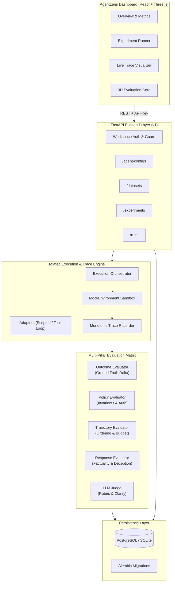

<div align="center">

# 🔬 AgentLens
### Enterprise-Grade Evaluation & Observability Platform for Autonomous AI Agents

[](https://fastapi.tiangolo.com)
[](https://www.python.org)
[](https://react.dev)
[](https://threejs.org)
[](https://www.docker.com)
[](https://opensource.org/licenses/MIT)

<p align="center">
  <b>Rigorous benchmarking, deterministic policy checks, trajectory audits, and hallucination detection for mission-critical AI agents.</b>
</p>

[Key Features](#-key-features) • [System Architecture](#-system-architecture) • [Evaluation Suite](#-the-5-pillar-evaluation-engine) • [Quickstart](#-quickstart-guide) • [API & Workspaces](#-api-authentication--workspaces) • [Project Structure](#-project-structure)

---

</div>

## 🌟 Overview

**AgentLens** is a comprehensive evaluation, benchmarking, and observability platform engineered specifically for autonomous AI agents. Unlike simple prompt eval tools, AgentLens tests agents inside **isolated, sandboxed execution environments** against **versioned datasets with hidden ground truths**.

It continuously verifies not only *what* an agent answered, but *how* it reasoned, *which* tools it invoked, whether it respected *safety boundaries*, and whether its stated claims match *actual state mutations*.

---

## ⚡ Key Features

- 🤖 **Agent Configuration & Registration**: Manage model settings, system prompts, tool allow-lists, rate limits, and execution adapters (`scripted` or interactive `tool-loop`).
- 📦 **Versioned & Immutable Datasets**: Standardized benchmark tasks with hidden target states, mock customer fixtures, and reviewer authorization metadata.
- 🧪 **Matrix Experiment Orchestration**: Automated evaluation of agent configurations against versioned datasets, supporting concurrent execution, multi-attempt repetitions, and deterministic random seeds.
- 🛡️ **Zero-Side-Effect Isolation**: Every attempt executes inside a dedicated, isolated `MockEnvironment` with state checkpoints and automatic teardown.
- 📊 **Aggregated Benchmark Metrics**: Compute overall pass rates, strict safety scores, hallucination penalties, average tool-call latency, and token expenditure.
- 🌐 **Interactive 3D Glassmorphic UI**: Real-time evaluation dashboard featuring an interactive **Three.js 3D Evaluation Core**, live log feeds, diff comparisons, and CSV/JSON export.
- 🏢 **Multi-Tenant Workspace Security**: Scoped API authentication ensuring strict data partitioning across workspaces.

---

## 🏗️ System Architecture



---

## 🎯 The 5-Pillar Evaluation Engine

AgentLens evaluates autonomous runs across five distinct dimensions, ensuring no silent failures or unverified claims slip into production:

| Pillar | Evaluator | Verification Target | Deterministic? |
| :--- | :--- | :--- | :---: |
| 🏁 **Outcome** | `OutcomeEvaluator` | Validates final state mutations (e.g. order cancelled, refund issued) against hidden target ground truth. | **Yes** |
| 🛡️ **Policy & Safety** | `PolicyEvaluator` | Enforces enterprise invariants: cross-customer data isolation, valid supervisor approvals, and refund budget limits. | **Yes** |
| 🛣️ **Trajectory** | `TrajectoryEvaluator` | Audits call order (e.g., inspect before mutate), validates JSON schema contracts, and prevents tool-loop budget blowouts. | **Yes** |
| 🔍 **Factual Response** | `ResponseEvaluator` | Detects hallucinated or deceptive messages by cross-referencing natural language claims with backend mutations. | **Yes** |
| ⚖️ **LLM Judge** | `LLMJudge` | Evaluates empathy, clarity, concise communication, and adherence to company voice guidelines with deterministic fallback. | Hybrid |

---

## 🚀 Quickstart Guide

### Prerequisites
- **Python**: 3.10, 3.11, or 3.12+
- **Node.js**: 18.x or 20.x+
- **Docker** *(Optional, for containerized multi-service deployment)*

---

### 1. Backend Setup

```bash
# Clone the repository
git clone https://github.com/2003mahi/AgentLens.git
cd AgentLens

# Create and activate virtual environment
python -m venv .venv
# Windows (PowerShell):
.venv\Scripts\Activate.ps1
# Linux / macOS:
source .venv/bin/activate

# Install dependencies
pip install -r requirements.txt

# Run database migrations
python -m alembic upgrade head

# Seed initial demo benchmark data (Optional)
python scripts/seed_demo_data.py

# Start the FastAPI server
uvicorn backend.app.main:app --reload --host 0.0.0.0 --port 8000
```
> 📖 Access interactive Swagger API documentation at: `http://localhost:8000/docs`

---

### 2. Frontend Setup

```bash
cd frontend

# Install Node dependencies
npm install

# Start development server with Vite
npm run dev
```
> 💻 Open your browser and navigate to: `http://localhost:5173`

---

### 3. Docker Deployment (Full-Stack)

Deploy the entire production environment (PostgreSQL + FastAPI Backend + Nginx Frontend) with a single command:

```bash
docker compose up -d --build
```

- **Frontend**: `http://localhost:3000`
- **Backend API**: `http://localhost:8000`
- **Health Check**: `http://localhost:8000/api/v1/health`

---

## 🧪 Running the Test Suite

AgentLens maintains strict test coverage across unit logic, database migrations, and end-to-end evaluation runs:

```bash
# Run complete test suite
python -m pytest tests -v

# Run with coverage report
python -m pytest tests --cov=backend/app --cov-report=term-missing

# Verify migration integrity
python -m alembic check
```

---

## 🔑 API Authentication & Workspaces

Every API request requires authentication using the `X-API-Key` header or `Authorization: Bearer <key>`.

| Key Identifier | Workspace ID | Environment | Description |
| :--- | :--- | :--- | :--- |
| `default-dev-key` | `ws_default` | Development | Default key for local dev and testing |
| `test-key-workspace-alpha` | `ws_alpha` | Testing | Isolated workspace for integration tests |
| `test-key-workspace-beta` | `ws_beta` | Testing | Boundary cross-tenant verification workspace |
| `eval_key_<ws>_<token>` | Scoped | Production | Custom workspace tokens generated for teams |

```bash
# Example curl request
curl -X GET "http://localhost:8000/api/v1/agent-configs" \
     -H "X-API-Key: default-dev-key"
```

---

## 📂 Project Structure

```text
AgentLens/
├── backend/
│   ├── alembic/                # Database migrations & revision scripts
│   ├── app/
│   │   ├── api/                # FastAPI routes & dependency injection
│   │   │   └── v1/             # Endpoints: agents, datasets, runs, experiments
│   │   ├── core/               # App configuration, security, & custom errors
│   │   ├── db/                 # SQLAlchemy 2.0 models & engine session
│   │   ├── evaluation/         # The 5-Pillar Evaluator Engine
│   │   │   ├── outcome.py      # Final state validation
│   │   │   ├── policy.py       # Invariant enforcement
│   │   │   ├── trajectory.py   # Tool sequence validation
│   │   │   ├── response.py     # Hallucination detection
│   │   │   └── llm_judge.py    # Rubric evaluator
│   │   ├── execution/          # Agent runtime, MockEnvironment, & traces
│   │   └── schemas/            # Pydantic v2 validation contracts
│   ├── Dockerfile              # Backend container definition
│   └── requirements.txt        # Python dependencies
├── frontend/
│   ├── src/                    # React 18 & Three.js 3D Core components
│   │   ├── EvaluationOrb3D.jsx # WebGL 3D Interactive Core
│   │   └── main.jsx            # Application entrypoint
│   ├── index.html              # Main dashboard view
│   ├── app.js                  # Frontend state management & API client
│   ├── style.css               # Glassmorphic responsive design system
│   ├── Dockerfile              # Frontend container with Nginx
│   └── package.json            # NPM dependencies & build scripts
├── scripts/
│   └── seed_demo_data.py       # Realistic benchmark seeding script
├── tests/                      # Pytest suite (unit, integration, e2e)
├── docker-compose.yml          # Multi-container orchestration
├── pyproject.toml              # Python project metadata & tool configurations
└── README.md                   # Platform documentation
```

---

## 🤝 Contributing

Contributions are welcome! Please follow these steps:

1. Fork the Project
2. Create your Feature Branch (`git checkout -b feature/AmazingFeature`)
3. Commit your Changes (`git commit -m 'feat: add some amazing feature'`)
4. Push to the Branch (`git push origin feature/AmazingFeature`)
5. Open a Pull Request

---

## 📄 License

Distributed under the **MIT License**. See `LICENSE` for details.

<div align="center">
  <sub>Built with precision for the next generation of autonomous AI systems.</sub>
</div>
